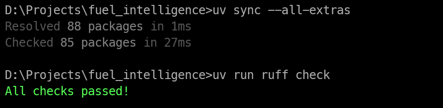
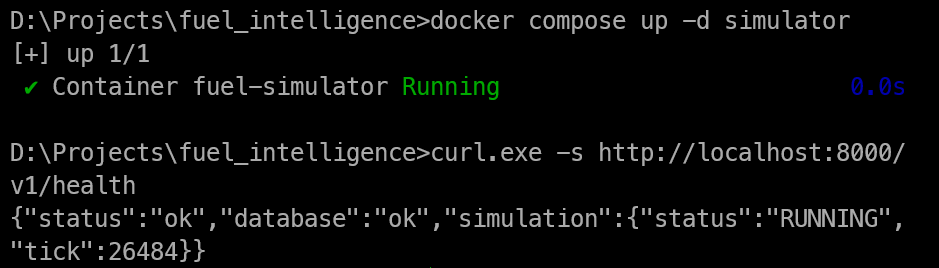

# Day 1 (2026-11-19) — Project Setup & Planning

**Goal:** Set up the project folder, Python tools, Docker simulator, and architecture notes so we have a clean base to build on.

---

## Block 1: Repo Setup, Python Environment & CI

- Created the project structure with `pyproject.toml`, `uv.lock`, `.env.example`, and `.gitignore`.
- Set up GitHub Actions CI (`.github/workflows/ci.yml`) so linting and tests run automatically.
- Added the hackathon PDFs and starter docs (`README.md`, `docs/ARCHITECTURE.md`, `docs/DECISIONS.md`, `docs/RUNBOOK.md`, `docs/EVIDENCE.md`, `docs/SIMULATOR_NOTES.md`).

---

## Block 2: BUP Fuel Simulator via Docker

- Added `docker-compose.yml` to run the `bup-fuel-supply-simulator` container on port `8000`.
- Configured health checks and environment variables (`SIMULATION_SPEED`, `TICK_MINUTES`, `SIMULATOR_START_MODE`).

