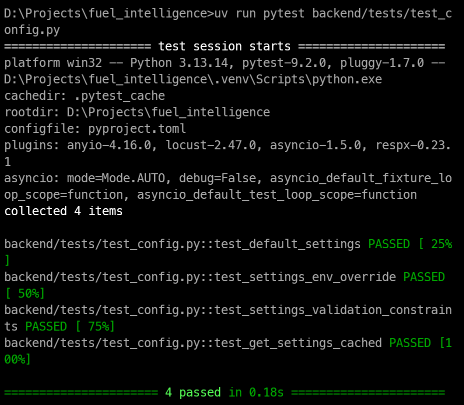
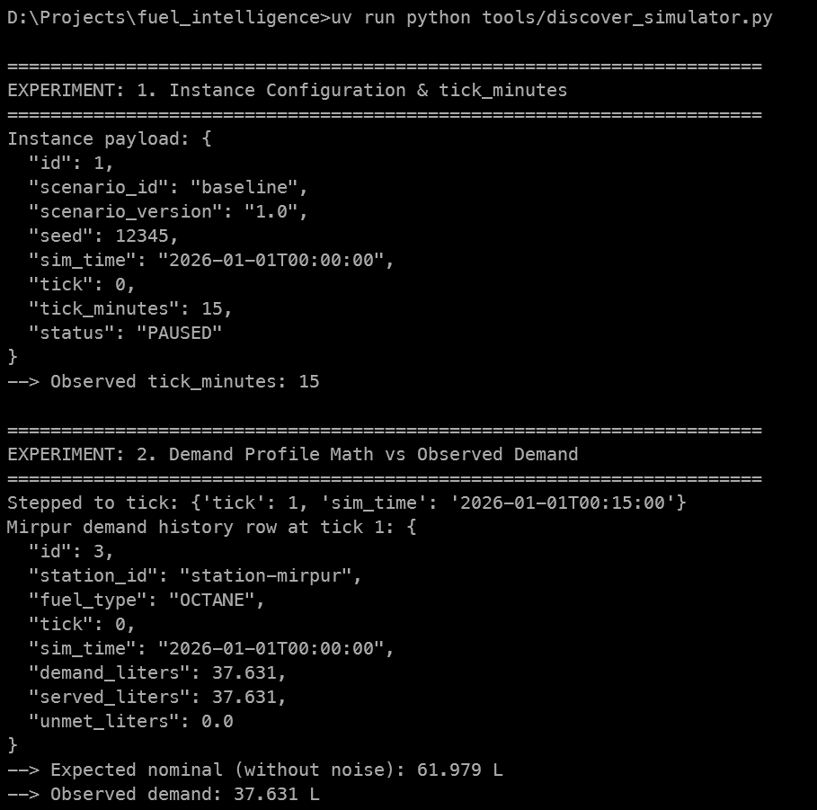
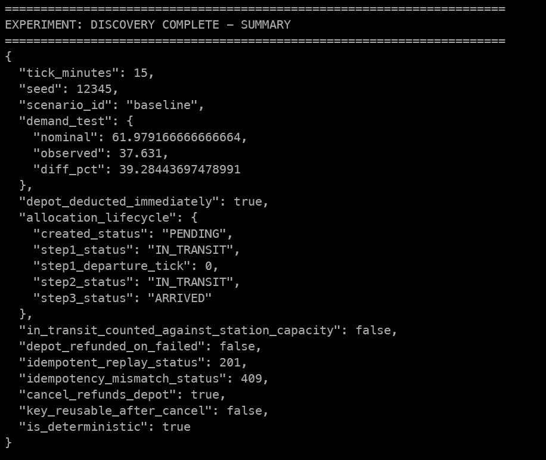
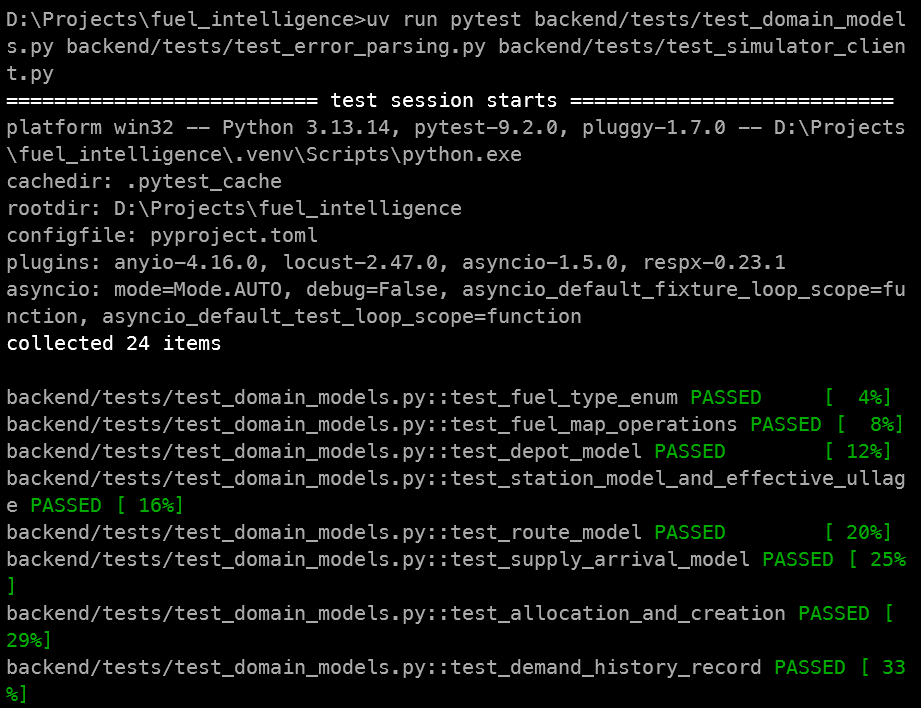
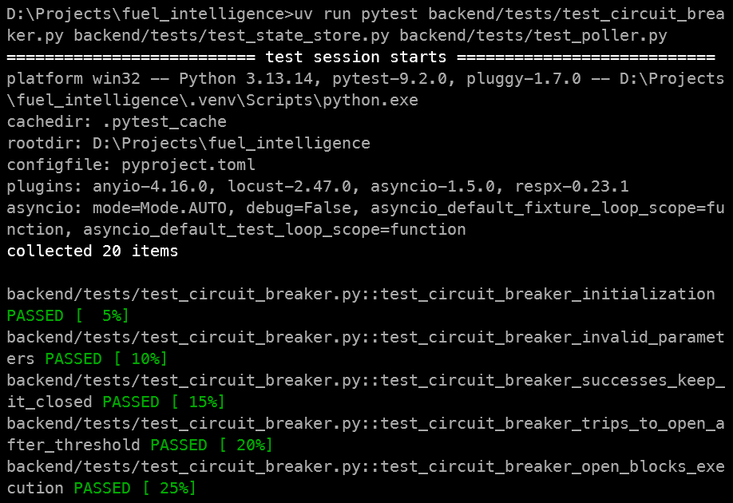
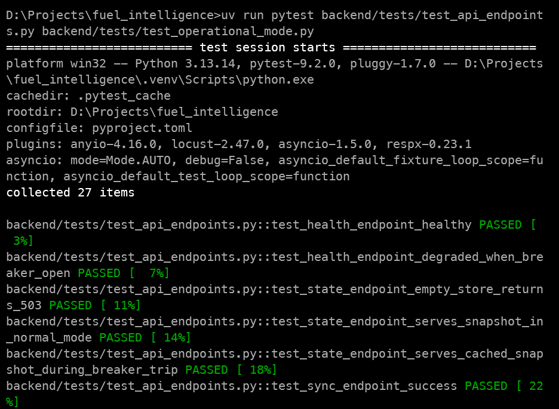
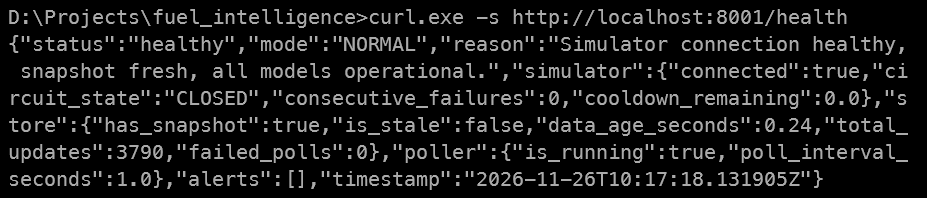

# Day 2 (2026-11-22) — Simulator Connection, Safety & Backend API

**Goal:** Connect safely to the fuel simulator, handle failures without crashing, store live snapshots in memory, and expose our first FastAPI endpoints.

---

## Block 1: Simulator Discovery & Config

- Built `tools/discover_simulator.py` to inspect what endpoints and data fields the simulator actually returns.
- Created `backend/app/config.py` to load settings (URLs, timeouts, polling intervals) cleanly.
- Updated `docs/SIMULATOR_NOTES.md` with real observations from the simulator.

---

## Block 2: Domain Models & Safe Simulator Client

- Defined clean Pydantic data models in `backend/app/domain/models.py` (depots, stations, routes, arrivals, allocations).
- Built `backend/app/adapters/simulator_client.py` and `errors.py` so every call to the simulator has timeouts, retries with backoff, and error parsing.

---

## Block 3: Circuit Breaker, State Store & Background Poller

- Added a **Circuit Breaker** (`backend/app/resilience/breaker.py`): if the simulator keeps failing, we stop hammering it and switch to safe mode, then test again later.
- Added an **In-Memory State Store** (`backend/app/ingest/store.py`) to keep the latest snapshot and the last good snapshot.
- Added an **Atomic Background Poller** (`backend/app/ingest/poller.py`) that fetches new data every second in the background.

---

## Block 4: FastAPI Backend & Operational Modes

- Created the FastAPI app (`backend/app/api/main.py`, `routes.py`, `schemas.py`, `deps.py`).
- Added operational mode tracking (`backend/app/resilience/mode.py`) so the system clearly reports `NORMAL`, `DEGRADED_CACHED`, or `DEGRADED_FALLBACK`.
- Added `/health` and `/state` endpoints.

