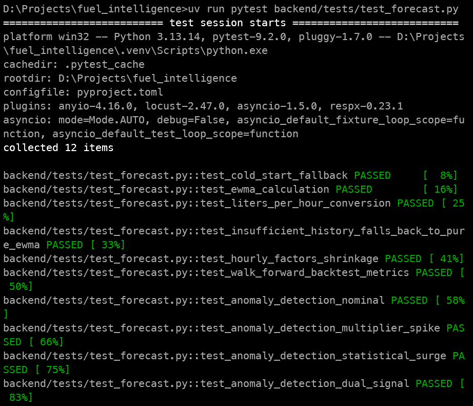
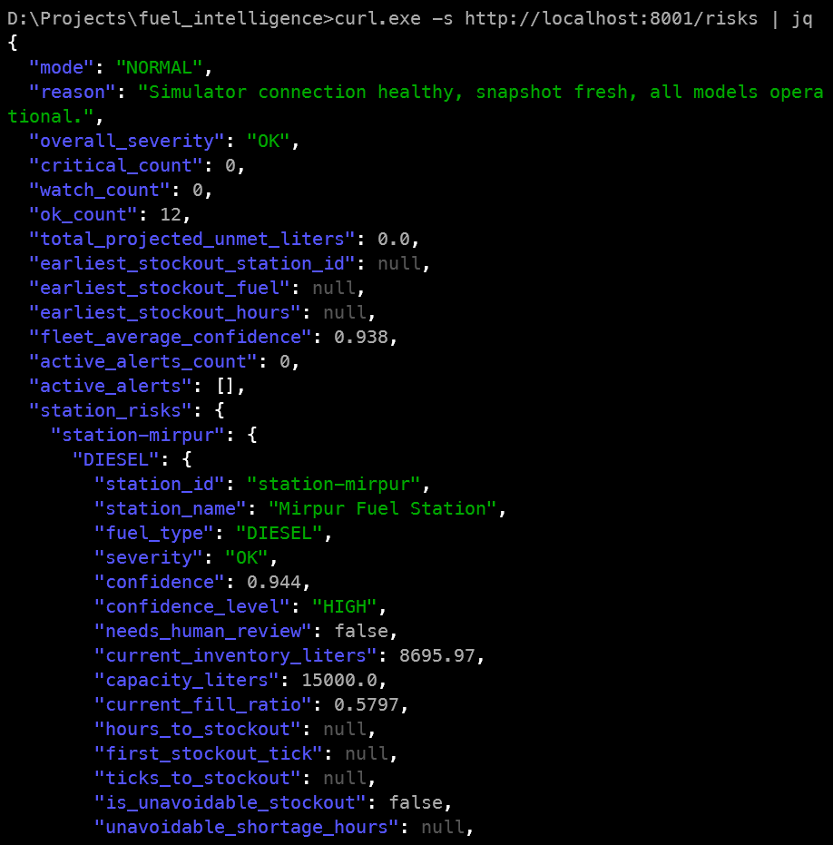
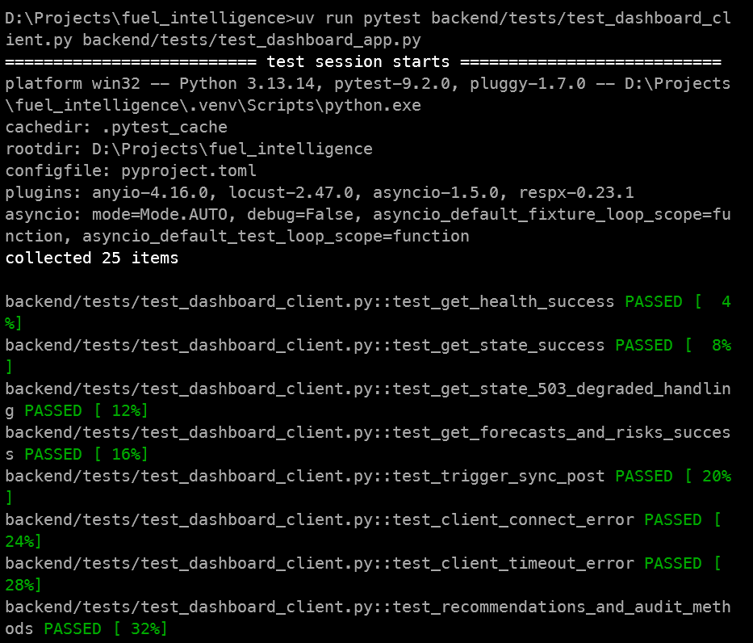
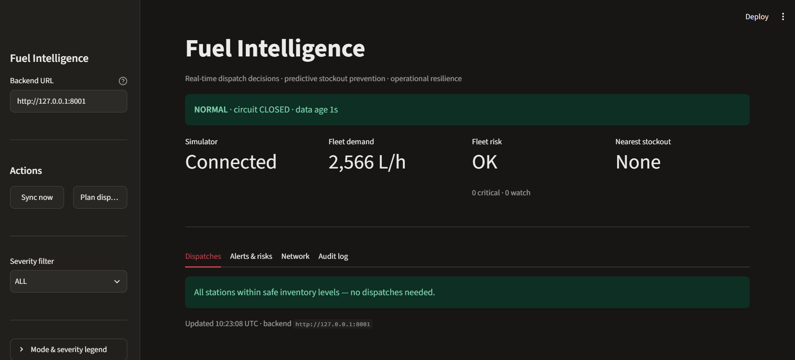
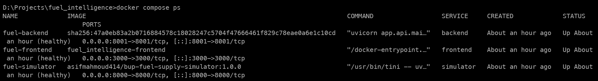

# Day 3 (2026-11-23) — Forecasting, Risk Alerts, Streamlit Dashboard & Docker

**Goal:** Predict future fuel demand, spot which stations are about to run out of fuel, show everything in a Streamlit dashboard, and run the whole stack in Docker.

---

## Block 1: Demand Forecaster & Anomaly Detector

- Built `backend/app/intelligence/forecast.py` to predict upcoming fuel demand at multiple levels with uncertainty bounds.
- Added an anomaly detector to catch sudden demand spikes.
- Added walk-forward backtesting to check forecast accuracy.

---

## Block 2: Inventory Risk Engine & Stockout Alerts

- Built the risk engine (`backend/app/intelligence/risk.py`) to calculate how many hours/ticks each station has before running out of fuel.
- Added urgency levels and risk alerts, and exposed them on the API (`/risks`).

---

## Block 3: Dashboard v1 (Streamlit Thin Client)

- Built `dashboard/app.py` and `dashboard/client.py` as a thin UI that only talks to our FastAPI backend.
- Fixed import paths and risk dictionary keys so Streamlit runs smoothly both standalone and in Docker.

---

## Block 4: Docker Compose Full Stack

- Added `backend/Dockerfile` and `dashboard/Dockerfile`.
- Updated `docker-compose.yml` so Simulator, Backend, and Dashboard start together with health checks.

