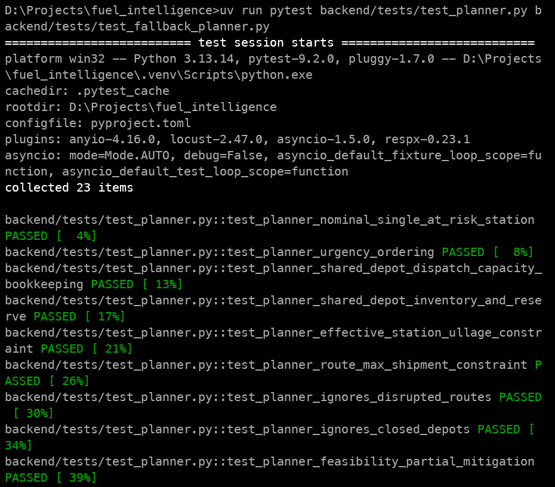
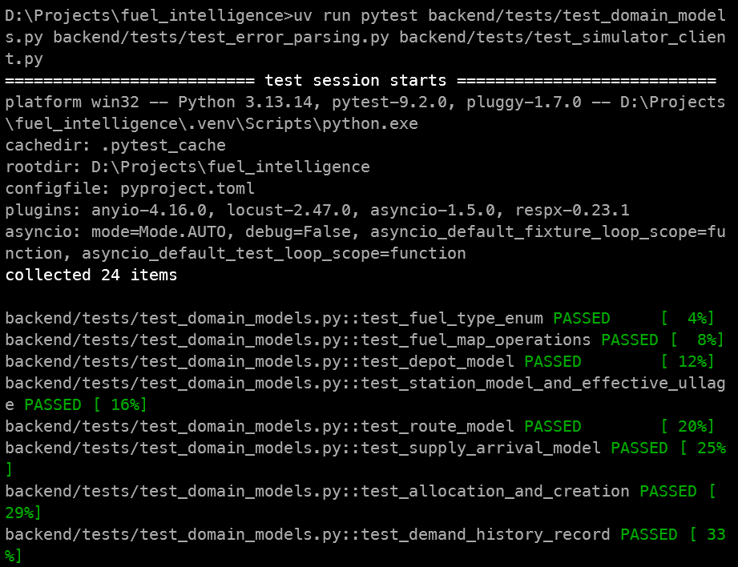
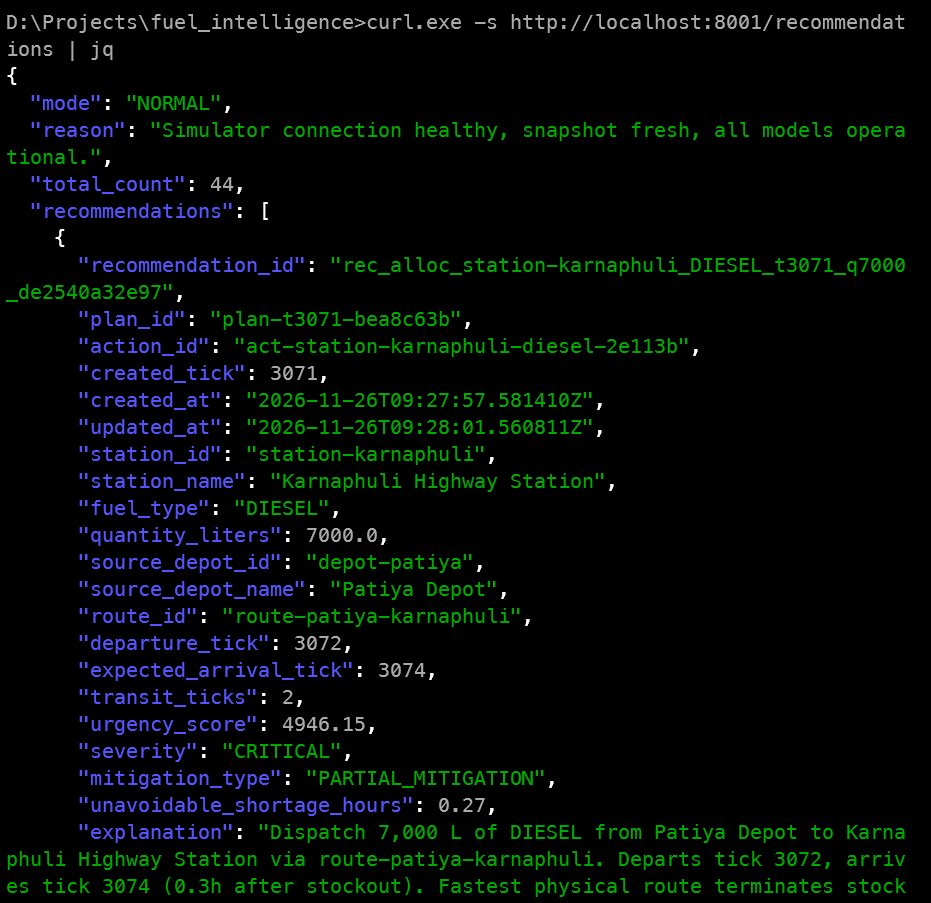
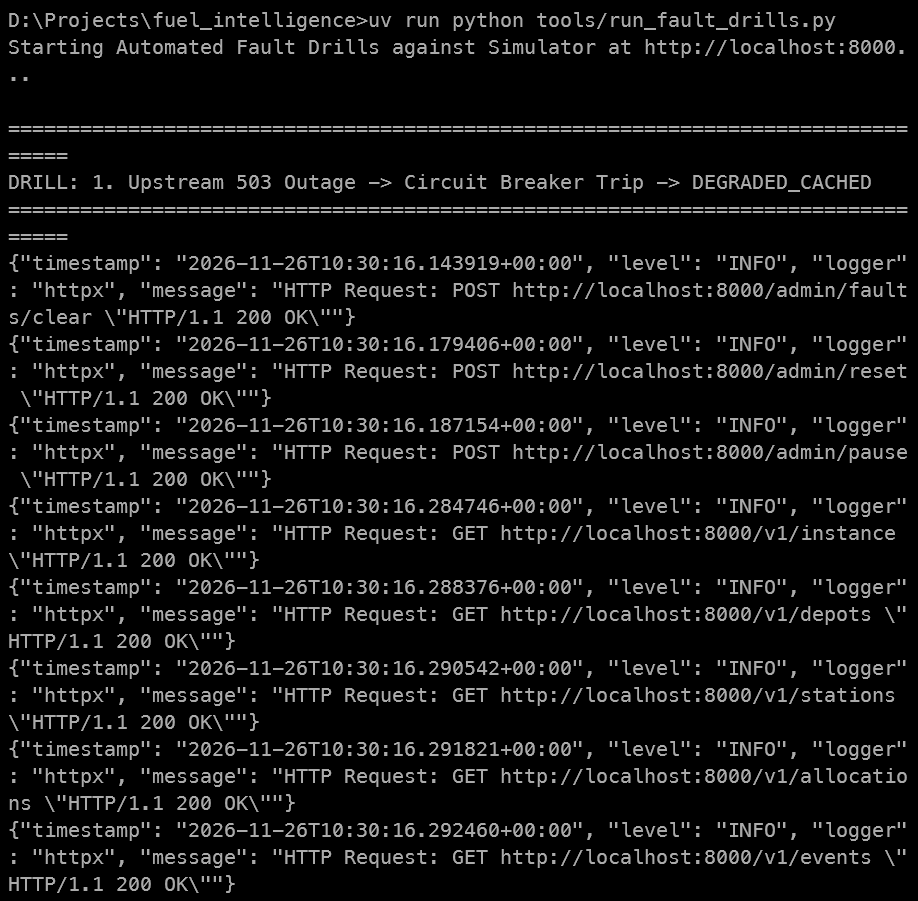

# Day 4 (2026-11-24) — Dispatch Planner, Digital Twin, Approvals & Fault Drills

**Goal:** Recommend which trucks/fuel to send where, test plans with a Monte Carlo Digital Twin, let humans approve/reject with a permanent SQLite log, and prove the system survives simulated failures.

---

## Block 1: Constrained Greedy Dispatch Planner

- Built `backend/app/intelligence/planner.py` to suggest optimal fuel dispatches while respecting depot stock, truck/route limits, and station capacity.
- Added a safe fallback heuristic (`backend/app/intelligence/fallback.py`) for `DEGRADED_FALLBACK` mode if the main planner/forecaster fails.
 Terminal showing `test_planner.py` and `test_fallback_planner.py` passing.

---

## Block 2: Monte Carlo Digital Twin

- Built the Digital Twin simulator (`backend/app/intelligence/twin.py`) that runs multiple random future scenarios ("what-if" simulations) to show how much a dispatch plan reduces stockout risk.

---

## Block 3: Recommendations, Human Approval & SQLite Audit Ledger

- Built `backend/app/decisions/` (service + SQLite audit ledger storing data in `data/decisions.db`).
- Added `/recommendations` and `/decisions` API endpoints so operators can review, approve, or reject dispatches, and every action is permanently recorded.

---

## Block 4: Fault Drills Harness

- Built `tools/run_fault_drills.py` to automatically inject faults (like 503 outages, slow responses, stale headers, bad data) and verify our platform degrades safely and recovers.
- Documented drill results in `docs/EVIDENCE.md`.

