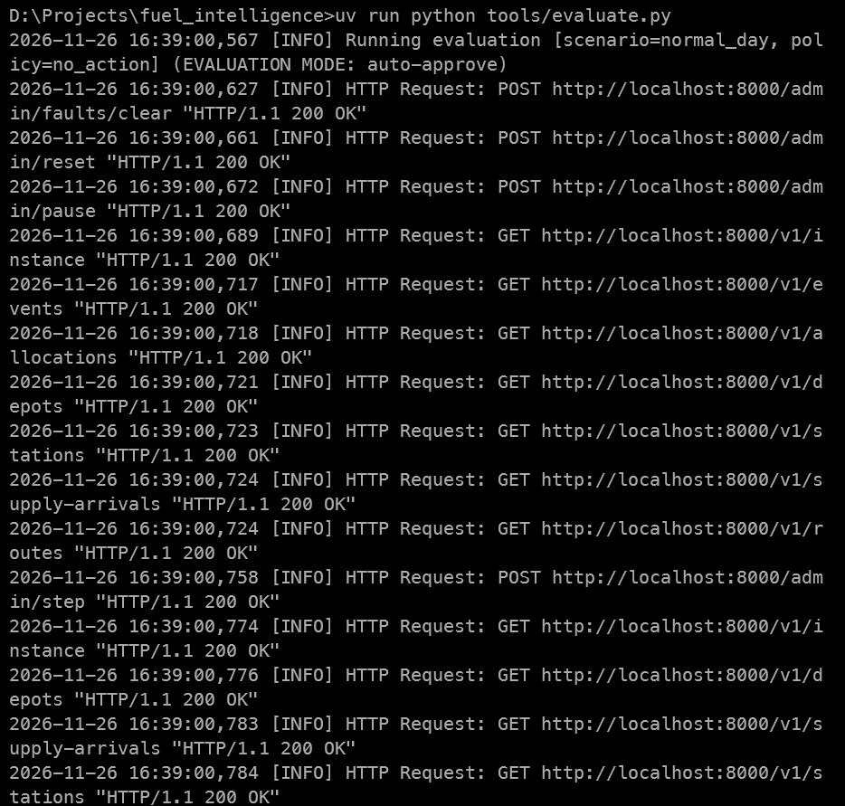
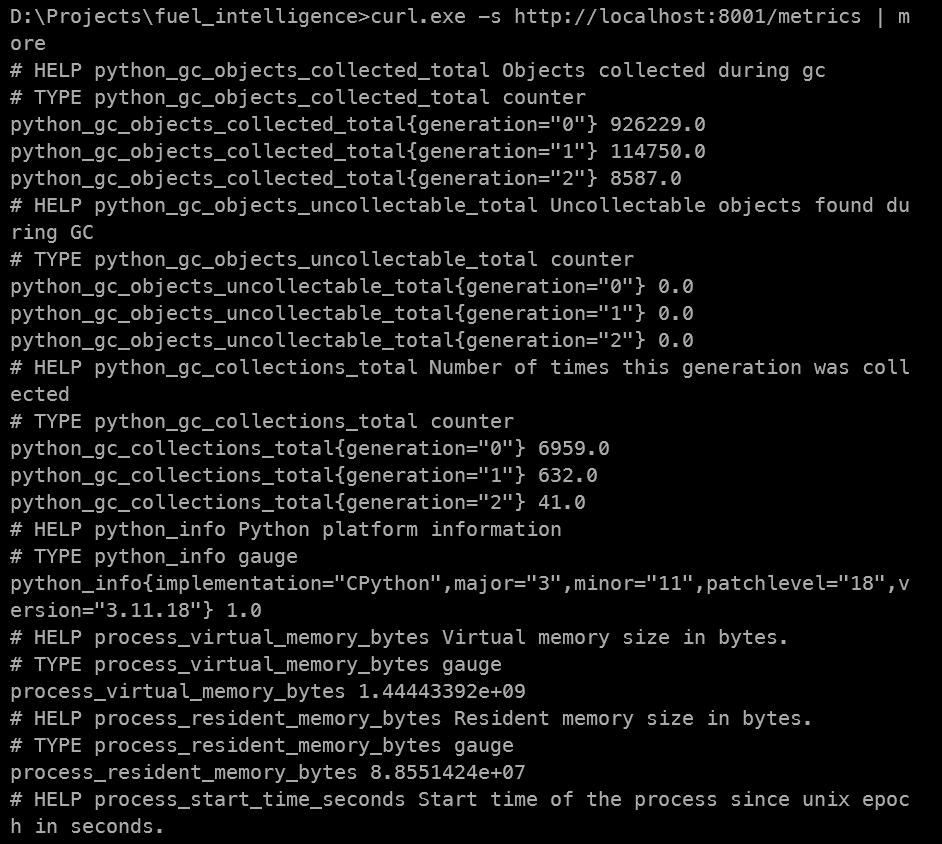

# Day 5 (2026-11-25) — Policy Evaluation & Observability

**Goal:** Measure how well our dispatch policy performs compared to baselines, and add Prometheus metrics + structured JSON logs so we can monitor everything.

---

## Block 1: Policy Evaluation Harness

- Built `tools/evaluate.py` to test our smart dispatch planner against simple baseline rules across scenarios and compare stockout rates and fuel delivered.
- Added unit tests in `backend/tests/test_evaluate.py`.

---

## Block 2: Prometheus Metrics, JSON Logging & Telemetry

- Added Prometheus metrics (`backend/app/observability/metrics.py`) to track request counts, latency, circuit breaker state, and operational mode.
- Added structured JSON logging (`backend/app/observability/logging.py`) across the simulator client, planner, decision service, and API.
- Added `/metrics` endpoint and wired telemetry into the dashboard client (`dashboard/client.py`, `dashboard/app.py`).

