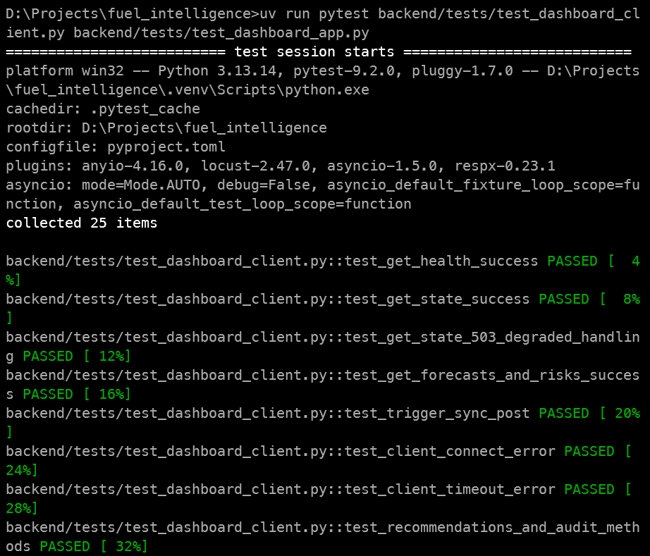
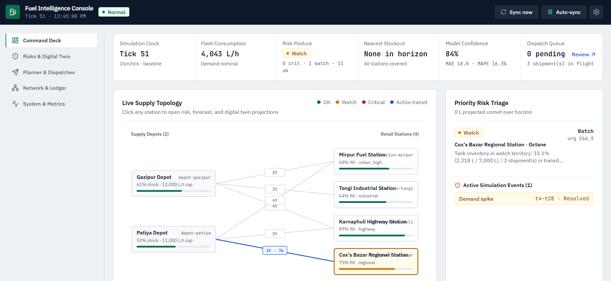
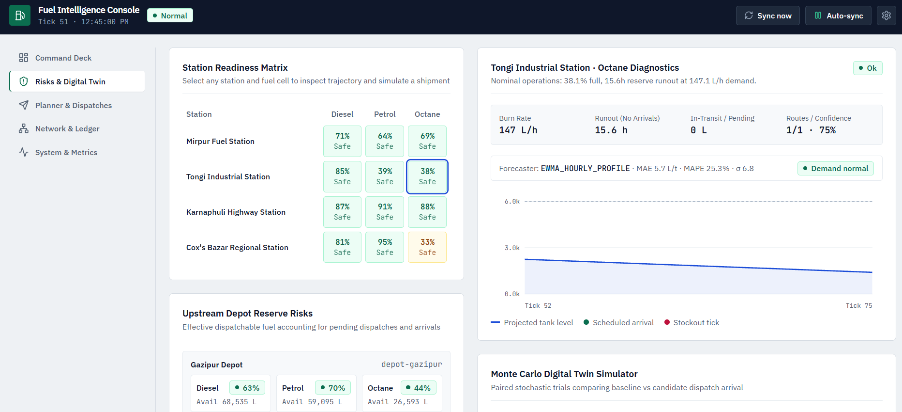
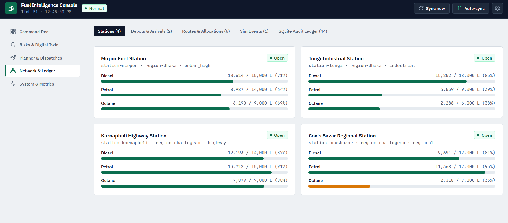
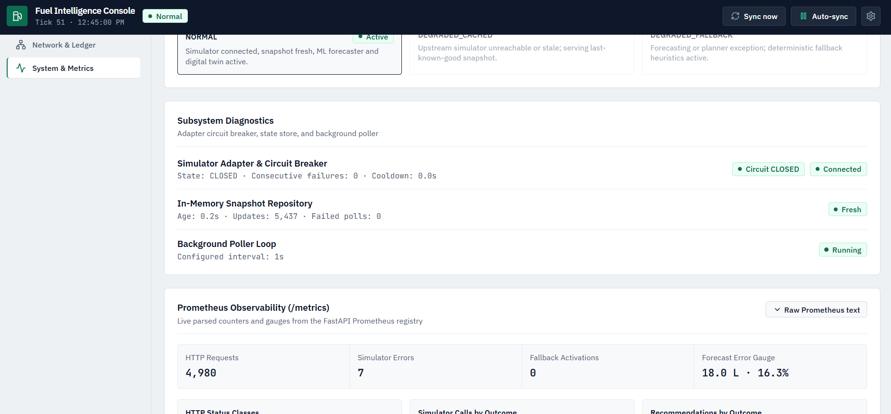
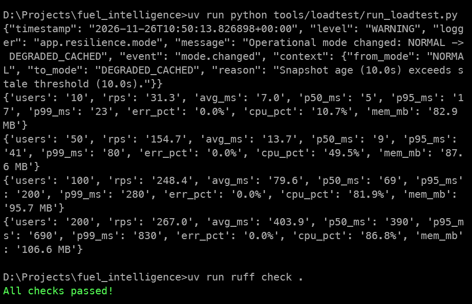

# Day 6 (2026-11-26) — React Console, Dashboard Polish, Load Test & CI

**Goal:** Build a modern React + TypeScript operator console, clean up the Streamlit dashboard, add load testing, and make sure all tests and CI checks pass.

---

## Block 1: Streamlit Dashboard Fix & Layout Cleanup

- Fixed `BackendApiClient.get_recommendations` limit parameter in `dashboard/client.py`.
- Refactored `dashboard/app.py` layout for cleaner readability and updated `backend/tests/test_dashboard_app.py`.

---

## Block 2: React + TypeScript Operator Console (`frontend/`)

### What we did

- Built a full React + TypeScript + Tailwind UI in `frontend/` aligned with our FastAPI backend.
- Added 5 main views:
  - **Overview** (`OverviewView.tsx`)
  - **Dispatches & Plan** (`DispatchesPlanView.tsx`)
  - **Intelligence & Digital Twin** (`IntelligenceTwinView.tsx`)
  - **Network & Audit Ledger** (`NetworkLedgerView.tsx`)
  - **System Health** (`SystemHealthView.tsx`)
- Added custom charts & network graph (`NetworkGraph.tsx`, `ForecastTrajectoryChart.tsx`, `TwinChart.tsx`).
- Added `frontend/Dockerfile` and `frontend/nginx.conf`, and wired `frontend` into `docker-compose.yml` on port `3000`.

---

## Block 3: Load Testing & Full CI Verification

### What we did

- Added load testing tools (`tools/loadtest/locustfile.py` and `tools/loadtest/run_loadtest.py`).
- Updated `.github/workflows/ci.yml` and `docs/EVIDENCE.md`.
- Cleaned up unused test imports so `ruff` CI passes cleanly.

